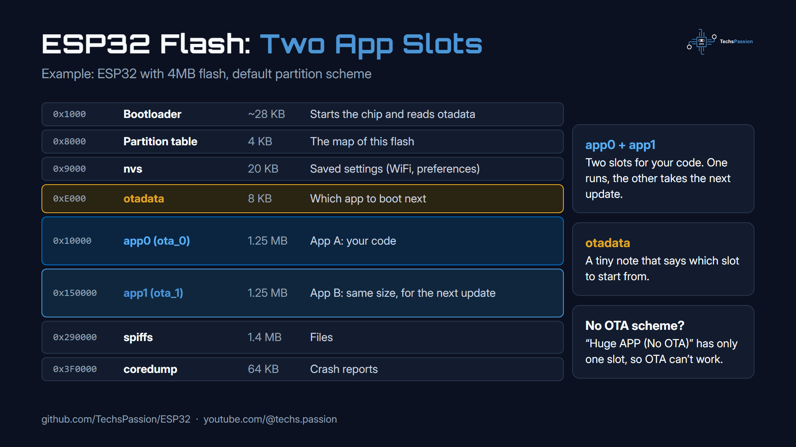
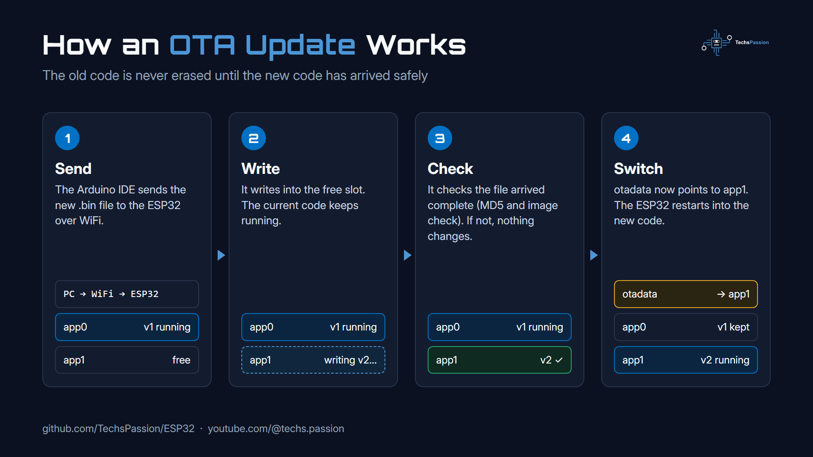
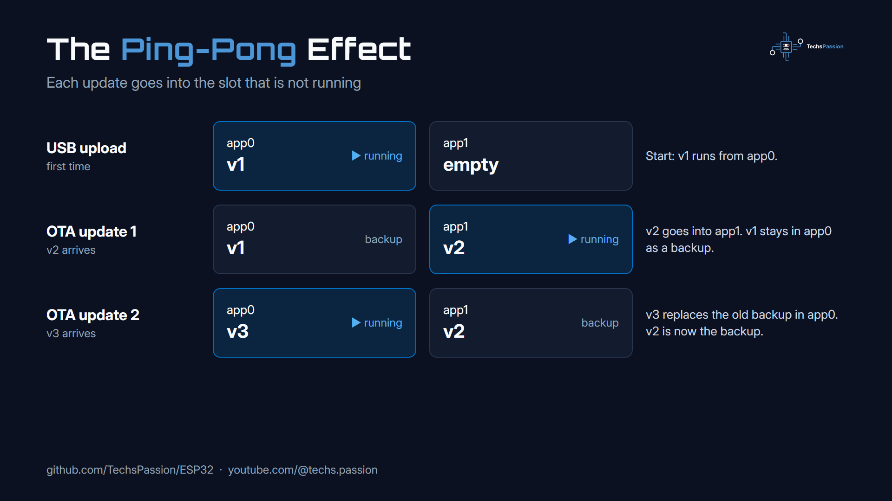
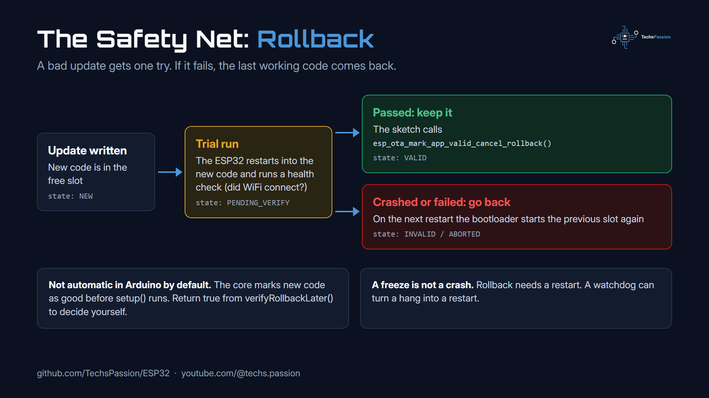
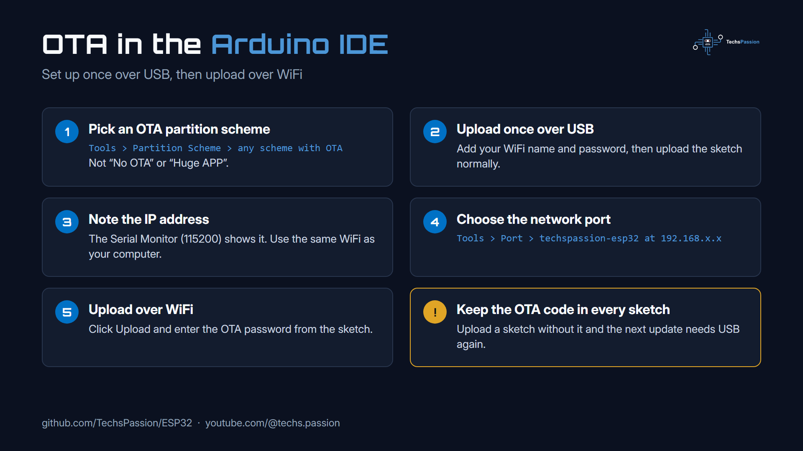

# ESP32 Over The Air (OTA) Upload

Upload code to your ESP32 over WiFi, no USB cable needed.

Watch the video on my YouTube channel: https://www.youtube.com/@techs.passion

## How it works

### 1. Two slots for your code

With an OTA partition scheme, the flash has **two app slots**:

- **app0** and **app1**: one holds the code that is running, the other receives the next update.
- **otadata**: a tiny partition that tells the ESP32 which slot to start from.

### 2. The update process

1. **Send**: the Arduino IDE sends the new code to the ESP32 over WiFi.
2. **Write**: the ESP32 writes it into the free slot while the current code keeps running.
3. **Check**: it checks the file arrived complete. If not, nothing changes.
4. **Switch**: it points otadata to the new slot and restarts into the new code.

### 3. The ping-pong effect

Each update goes into the slot that is **not** running, so the ESP32 switches between app0 and app1. The previous version stays in the other slot as a backup.

### 4. The safety net: rollback

Because the previous version is still there, the ESP32 can go back to it if a new update crashes before it is confirmed as working. In Arduino this is not on by default; it needs a few extra lines of code.

## Setup in the Arduino IDE

1. Open `OTA_Basic/OTA_Basic.ino` and enter your WiFi name and password.
2. Select your board in **Tools > Board**.
3. In **Tools > Partition Scheme**, pick one with OTA (not "No OTA" or "Huge APP"). For example:
   - ESP32 (4MB): **Default 4MB with spiffs**
   - ESP32-S3 (16MB): **16M Flash (2MB APP/12.5MB FATFS)**
4. Upload once over USB.
5. Open the Serial Monitor (115200) and note the IP address.
6. Change `blinkMs` (for example `1000` to `200`).
7. In **Tools > Port**, pick **techspassion-esp32** under Network ports.
8. Click **Upload** and enter the password `techspassion`.

The LED now blinks faster: the new code arrived over WiFi.

## Notes

- Your computer and the ESP32 must be on the same WiFi.
- Every sketch you upload must include the OTA code, or the next upload needs USB again.
- Keep `loop()` free of long `delay()` calls so the ESP32 can hear the next upload.
- ESP32-S3 with an empty Serial Monitor? Set **Tools > USB CDC On Boot > Enabled**.
- Network port not showing? Restart the Arduino IDE, and on Windows allow it through the firewall.

You can use this code however you like. Please consider liking and subscribing to my YouTube channel: https://www.youtube.com/@techs.passion
