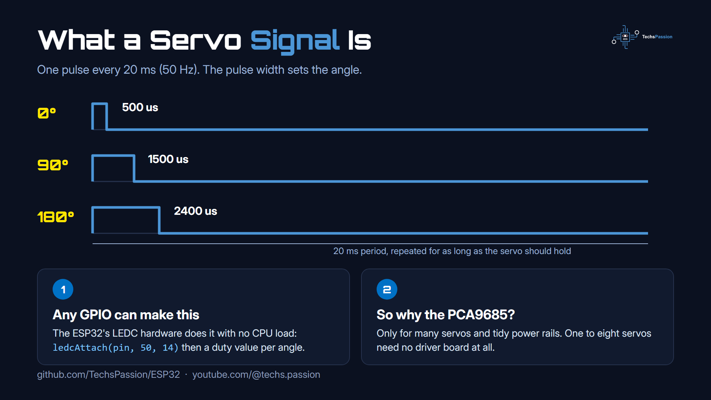
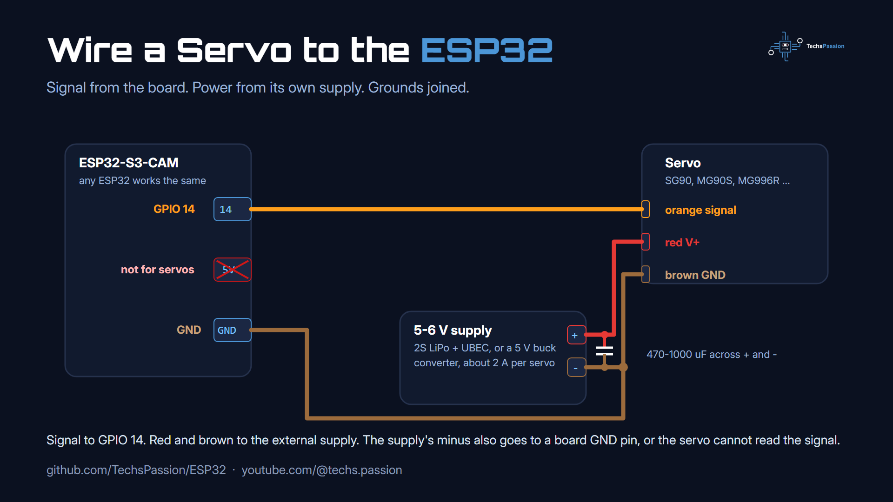
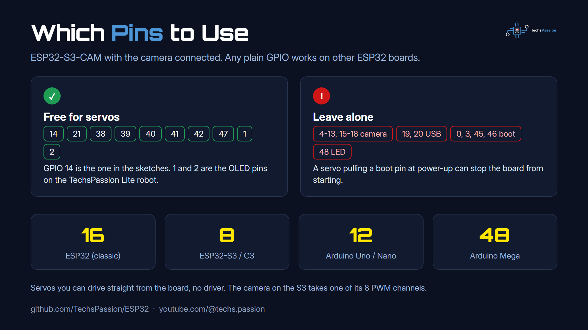
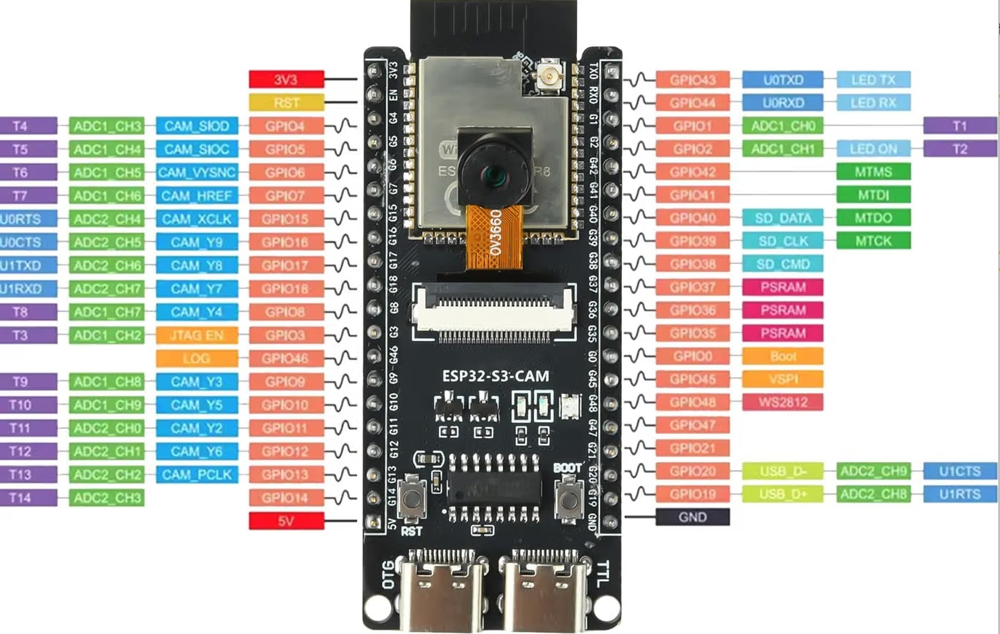

# Servo Straight From an ESP32 (No Driver Board)

Run a hobby servo from an ESP32 GPIO pin. No PCA9685, no library.

Watch the video: https://youtu.be/dM0Tc3F-pVU

## How it works

A servo wants one pulse every 20 ms. The pulse width sets the angle. The ESP32 makes that pulse with its own PWM hardware on any GPIO.



## Wiring



| Servo wire | Goes to |
|---|---|
| Orange / yellow (signal) | ESP32 **GPIO 14** |
| Red (V+) | External 5-6 V supply (+) |
| Brown / black (GND) | External supply (−) **and** an ESP32 GND pin |

- Do not power the servo from the board's 5 V or 3.3 V pin. A stalled servo resets the ESP32.
- Check the voltage: SG90 / MG90S servos are rated 4.8-6 V. A 2-cell 18650 pack is 7.4-8.4 V, which is too much on its own; put a 5 V regulator (buck converter / BEC) between the pack and the servo, or use 4 NiMH AA cells (4.8 V).
- Put a 470-1000 µF capacitor across the servo supply.
- The ESP32 signal is 3.3 V. SG90 / MG90S class servos accept it.

## Which pin



GPIO 14 is free on the ESP32-S3-CAM (the camera uses 4-13 and 15-18). On other boards any plain GPIO works; avoid the boot pins (0, 3, 45, 46) and the USB pins (19, 20).

## Do you need a PCA9685?

Only when your board runs out of servo outputs. Each servo needs its own PWM signal; the wiring stays the same.

| Board | Servos straight from the pins |
|---|---|
| ESP32 (classic) | 16 |
| ESP32-S3 | 8 (7 while the camera runs, it uses one PWM channel) |
| Arduino Uno / Nano (Servo library) | 12 |
| Arduino Mega (Servo library) | 48 |
| Raspberry Pi | 2 hardware PWM channels on most models. More is possible with software PWM, but it jitters. |

Need more than that? A PCA9685 adds 16 servo outputs over I2C, and you can chain several boards on the same two wires.

<p align="center"></p>

## Upload

1. Open `Servo_Direct_From_ESP32.ino`.
2. **Tools > Board**: your ESP32 (for the ESP32-S3-CAM: *ESP32S3 Dev Module*, USB CDC On Boot enabled).
3. Upload over USB.

The servo sweeps 0 → 180 → 0. In the Serial Monitor (115200) type an angle (`0`-`180`) to move it there, or `s` to pause and resume.

## The code

```cpp
ledcAttach(servoPin, 50, 14);                 // 50 Hz, 14-bit duty

void servoWrite(int deg) {
  int us = map(deg, 0, 180, 500, 2400);       // pulse width for the angle
  uint32_t duty = (uint32_t)us * 16383 / 20000;
  ledcWrite(servoPin, duty);
}
```

If the servo buzzes at the end stops, change 500-2400 to 1000-2000. On Arduino esp32 core 2.x use `ledcSetup` + `ledcAttachPin` instead of `ledcAttach`.

## Disclaimer

This is a learning project, shared as is. Check your servo and power supply ratings before wiring, and build it at your own risk. The ESP32-S3-CAM pinout image is the seller's product image, included for reference.

You can use this code however you like. Please consider liking and subscribing to my YouTube channel: https://www.youtube.com/@techs.passion
