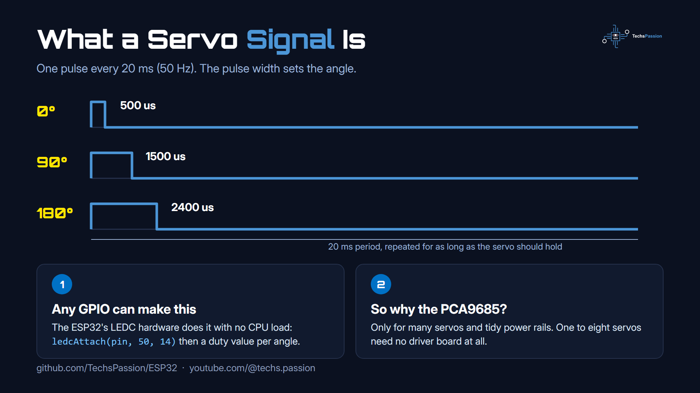
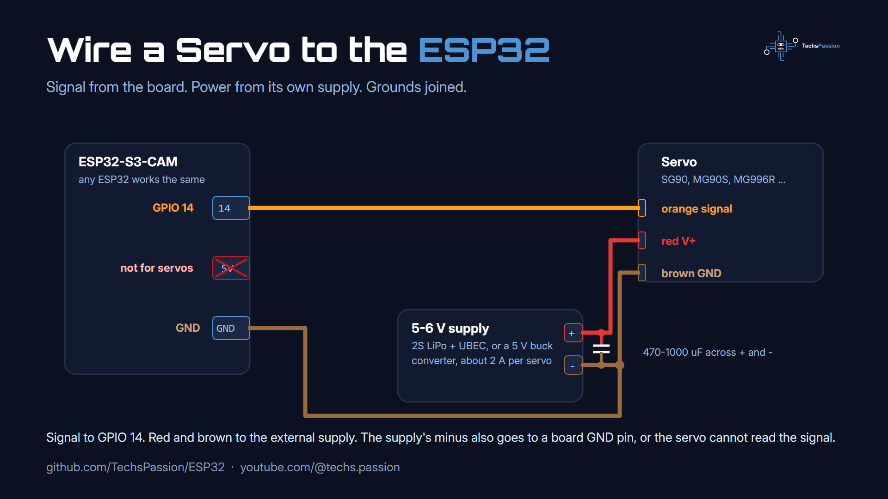
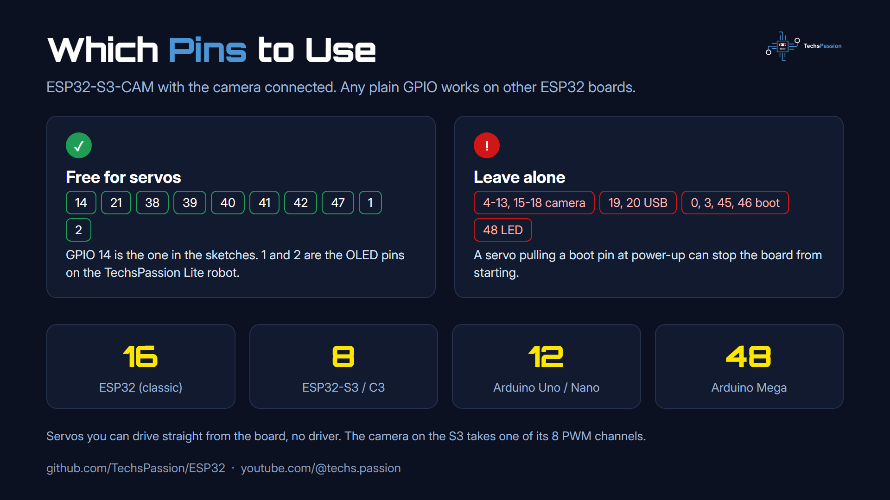
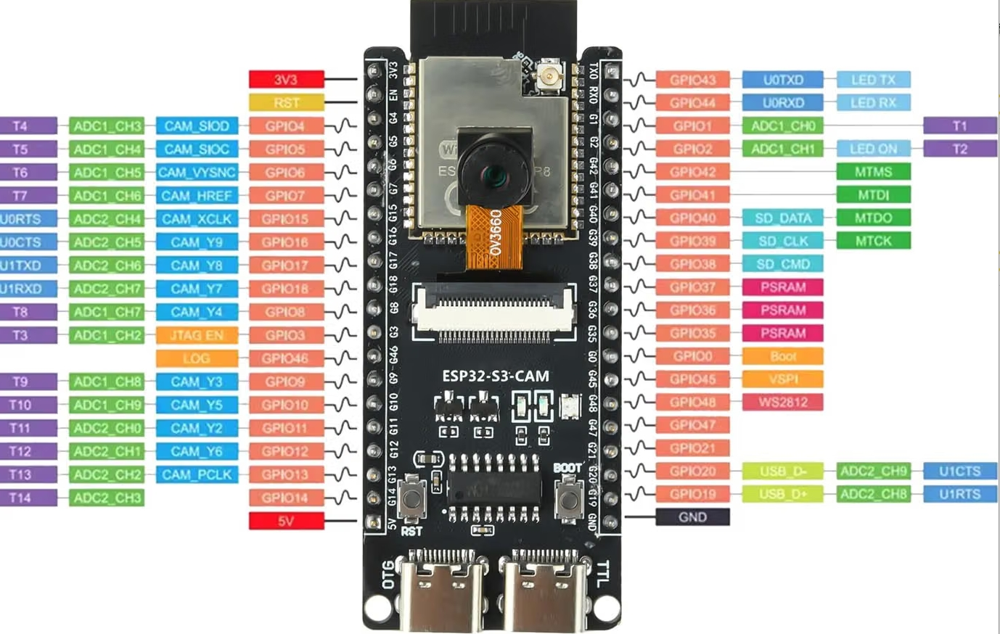
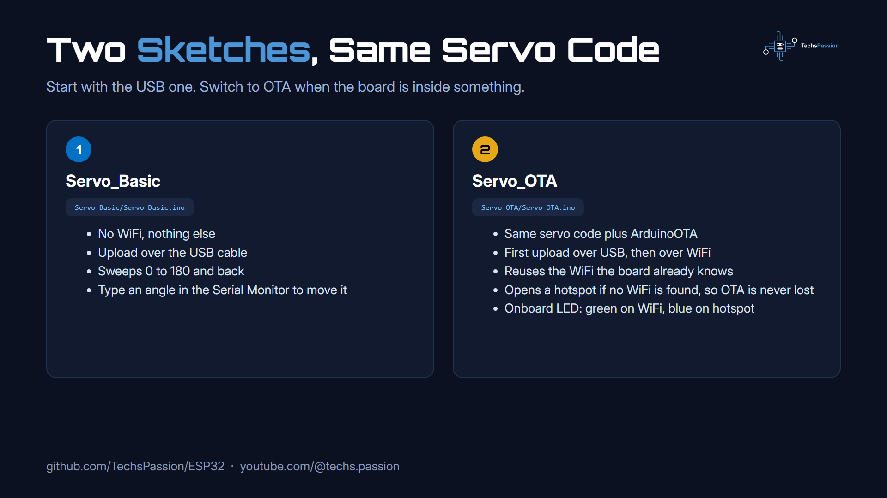

# Servo Straight From an ESP32 (No Driver Board)

Run a hobby servo from an ESP32 GPIO pin, with no PCA9685 or other driver board. Two sketches: one for the USB cable, one that updates over WiFi.

Watch the video on my YouTube channel: https://www.youtube.com/@techs.passion

## Why no driver board

A servo needs three things: a 50 Hz pulse on its signal wire, 5-6 V on its power wire, and a ground shared with whatever makes the pulse. The ESP32 can make that pulse on any GPIO with its built-in PWM hardware (LEDC), so a driver board only matters when you have many servos or want tidy power rails.



## Wiring



| Servo wire | Goes to |
|---|---|
| Orange / yellow (signal) | ESP32 **GPIO 14** |
| Red (V+) | External 5-6 V supply (+) |
| Brown / black (GND) | External supply (−) **and** an ESP32 GND pin |

- Never power the servo from the board's 5 V or 3.3 V pin. A stalled servo pulls more than the board can give and resets it.
- Put a 470-1000 µF capacitor across the servo supply, close to the servo.
- The ESP32 signal is 3.3 V. SG90 / MG90S class servos accept it; if one twitches, add a 74HCT125 level shifter on the signal line.
- Power the ESP32 separately (USB or its own regulator) so servo current dips do not reset it.

More servos: same wiring, each orange wire on its own GPIO. The limit is the number of PWM channels.



Pin 14 is free on the ESP32-S3-CAM used in my videos (the camera takes GPIO 4-13 and 15-18). On other boards any plain GPIO works; just avoid the boot/strapping pins.

<p align="center"></p>

## The two sketches



### 1. Servo_Basic (USB)

`Servo_Basic/Servo_Basic.ino` is the servo and nothing else.

1. Select your board under **Tools > Board** (for the ESP32-S3-CAM: *ESP32S3 Dev Module*, 16MB flash, USB CDC On Boot enabled).
2. Upload over USB.
3. The servo sweeps 0 → 180 → 0. Open the Serial Monitor at 115200 and type an angle (`0`-`180`) to move it there, or `s` to pause and resume the sweep.

### 2. Servo_OTA (WiFi)

`Servo_OTA/Servo_OTA.ino` is the same servo code plus the OTA setup from my [OTA guide](../OTA_Over_The_Air_Update).

1. Pick a partition scheme with OTA under **Tools > Partition Scheme** (for a 16 MB ESP32-S3: *16M Flash (2MB APP/12.5MB FATFS)*).
2. Upload once over USB.
3. From then on choose **Tools > Port > techspassion-esp32** under Network ports and upload over WiFi. The OTA password is `techspassion`.

The sketch reconnects to the WiFi the board already knows from the previous upload, so there is nothing to type in. If it cannot, it tries the network in `secrets.h`, and if that fails too it opens a hotspot called `techspassion-esp32` (password `techspassion`) where OTA still works at 192.168.4.1. The onboard LED shows the state: green on WiFi, blue on the hotspot, amber while an update is being written.

## How the servo code works

```cpp
ledcAttach(servoPin, 50, 14);                 // 50 Hz, 14-bit duty (16384 steps per 20 ms)

void servoWrite(int deg) {
  int us = map(deg, 0, 180, 500, 2400);       // pulse width for the angle
  uint32_t duty = (uint32_t)us * 16383 / 20000;
  ledcWrite(servoPin, duty);
}
```

No library. This also avoids the timer clash between the ESP32Servo library and the camera driver on camera boards. If your servo buzzes at the end stops, narrow the range to 1000-2000 µs.

## Notes

- Tested with the Arduino esp32 core 3.x. On core 2.x use `ledcSetup(channel, 50, 14)` + `ledcAttachPin(pin, channel)` and write to the channel.
- The ESP32-S3 has 8 PWM channels (one is used by the camera when it runs), the classic ESP32 has 16. Beyond that, use a PCA9685.
- For 18-servo builds like a hexapod the driver board is still the simplest option.

You can use this code however you like. Please consider liking and subscribing to my YouTube channel: https://www.youtube.com/@techs.passion
